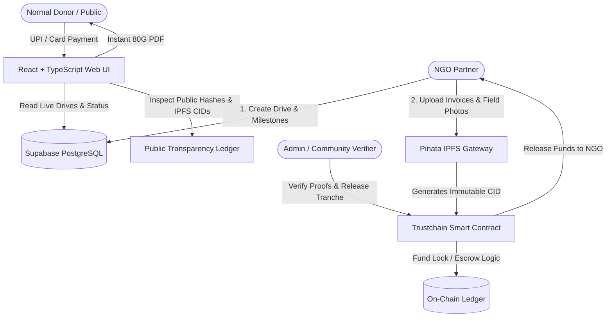

# 🎓 Trustchain: Final Year Project & Viva Presentation Guide

Welcome to the comprehensive presentation guide for **Trustchain** — a Hybrid Web2 + Web3 Milestone-Driven Transparent Donation Platform.

---

## 🌟 1. Project Concept & Problem Statement

### The Problem:
- **Lack of Trust in Charities**: Donors rarely know if their funds actually reached the intended cause or got lost in administrative overhead.
- **Crypto / Web3 Friction**: Pure blockchain platforms force normal donors to buy cryptocurrency, set up MetaMask wallets, and pay gas fees — leading to a 95%+ drop-off rate.

### The Solution:
**Trustchain** solves both problems with a **Hybrid Web2 UX + Web3 Transparency Architecture**:
1. **Frictionless Giving (Web2 UX)**: Donors donate using regular UPI QR, UPI ID, or Cards. No crypto knowledge required.
2. **80G Tax Exemption**: Automatic generation of compliant 80G tax exemption certificates in PDF format.
3. **Milestone Escrow Mechanism**: Donations are locked in milestone tranches. Funds are released only after the NGO submits verifiable proofs.
4. **Decentralized Media Storage (Pinata IPFS)**: Receipts, bills, and field photos are pinned to IPFS, ensuring proofs cannot be manipulated or deleted.
5. **Tamper-Proof Public Ledger**: Every donation and fund release is logged with a cryptographic transaction hash, publicly inspectable by anyone on the **Transparency Ledger**.

---

## 🏗️ 2. High-Level System Architecture



---

## ⚙️ 3. Technology Stack Breakdown

| Layer | Technology | Primary Responsibility |
| :--- | :--- | :--- |
| **Frontend** | React 19 + TypeScript + Vite | Responsive dashboard, UPI modal, 80G tax certificate generator, multi-language (i18n). |
| **Relational Database** | Supabase (PostgreSQL + Realtime) | Fast search, location/category filtering, user profiles, instant live updates. |
| **Decentralized Storage**| Pinata (IPFS) | Permanent, tamper-proof pinning of photos, PDF invoices, and geotag metadata. |
| **Blockchain / Escrow** | Solidity (`Trustchain.sol`) + Ethers.js | Milestone escrow locking, milestone verification hashes, release triggers. |
| **Backend API** | Node.js + Express | Admin verification webhooks, service-role audit logging. |

---

## 🚀 4. How to Run Locally

### Step 1: Start Frontend
```bash
cd Trustchain/frontend/web
npm install
npm run dev
```
Open [http://localhost:5173](http://localhost:5173) in your browser.

### Step 2 (Optional): Start Backend
```bash
cd Trustchain/backend
npm install
npm start
```

---

## ☁️ 5. Supabase Setup in 60 Seconds (Free Cloud DB)

1. Go to [supabase.com](https://supabase.com) and create a free project.
2. Open the **SQL Editor** in your Supabase dashboard.
3. Copy all contents of `Trustchain/backend/schema.sql` and click **RUN**.
4. Go to **Project Settings -> API** and copy:
   - `Project URL`
   - `anon public key`
5. Create a `.env` file in `Trustchain/frontend/web/`:
   ```env
   VITE_SUPABASE_URL=https://your-project.supabase.co
   VITE_SUPABASE_ANON_KEY=eyJhbGciOi...
   ```
*(Note: Even without Supabase keys, the app works 100% out of the box with offline demo state!)*

---

## 🎯 6. Frequently Asked Viva / Presentation Questions

### Q1: "Why use both Supabase AND Blockchain/IPFS?"
> **Answer**: 
> - **Blockchain** is slow, expensive, and cannot perform complex search or filtering queries (like finding campaigns by city or category).
> - **IPFS** is content-addressed file storage, not a database.
> - **Supabase** gives us blazing-fast relational queries and real-time frontend syncing, while **IPFS + Blockchain** ensure that financial proofs and audit trails cannot be altered by anyone.

### Q2: "Why don't donors need MetaMask?"
> **Answer**: 
> - Real-world donors in India and worldwide prefer UPI, Apple Pay, and Credit Cards.
> - Forcing crypto wallets kills user adoption.
> - We implement **Account Abstraction / Relayer-assisted transparency**: Donors pay in fiat/UPI, while the system automatically generates cryptographic verification hashes and anchors them to the public ledger.

### Q3: "What prevents an NGO from withdrawing all funds at once?"
> **Answer**:
> - Funds are divided into **Milestone Tranches** (e.g. 3 milestones = 33% each).
> - The Smart Contract escrow only releases Milestone 2 funds AFTER Milestone 1 proof (photos, bills) is uploaded to IPFS and approved by the verifier.

### Q4: "How is the 80G tax benefit handled?"
> **Answer**:
> - Each donation automatically checks the NGO's 80G registration certificate and generates a compliant PDF tax receipt with deduction calculations (50% or 100%) and PAN references.
